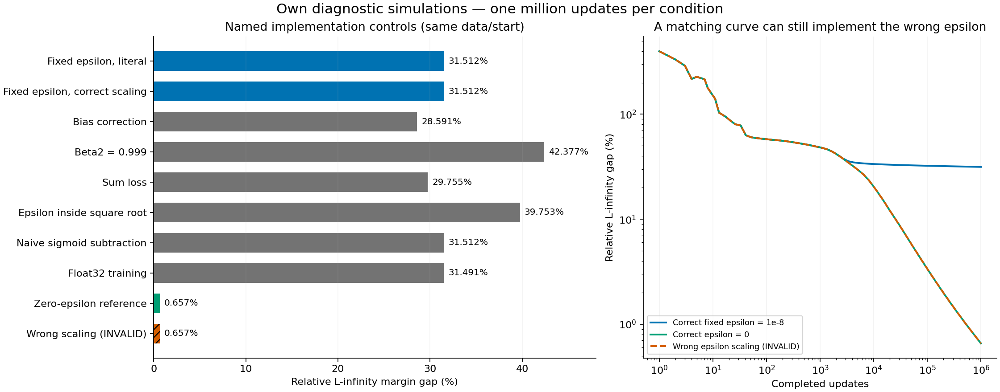
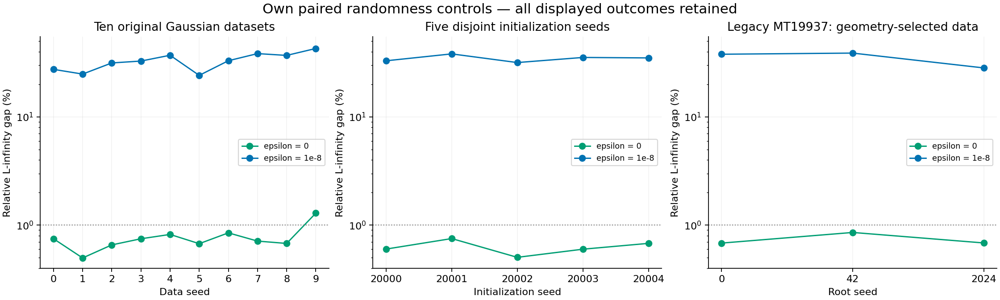

# Fixed-epsilon discrepancy: second diagnostic audit

The final result is in [results/2026-11-13-legend](results/2026-11-13-legend/README.md).
This file records a diagnostic study.

**The positive-epsilon overlap is still not reproduced.** After the Figure 1
learning-rate correction, we ran **56 additional million-step conditions**:
10 implementation-convention controls and 46 paired data/initialization/RNG
controls. We also checked selected updates using 80- and 120-digit Decimal
arithmetic and inspected the authors' TeX/figure archive. All planned production
outcomes are retained; no seed or curve was selected by optimizer performance.
These are AI-assisted independent diagnostics, not author code or a theorem
refutation. The matrices were informed by earlier results and fixed before the
respective production runs; they are not an external preregistration.

The frozen `run.py`, `protocol.json`, 2026-11-05 study and first alignment study
remain unchanged. A new data/reference identity guard prevents accidentally
mixing a saved dataset with another reference solution in the convention runner.
The first guarded-source production study was rerun in full; source hashes are
not retroactively assigned to executions of a different source version.

## 1. Ordinary implementation conventions do not close the gap here

All values below are relative **training L-infinity margin gaps**, not
classification errors. Every condition uses the same original seed-2 data and
initialization, one million updates, eta_t=(t+1)^(-.5), and epsilon=1e-8 unless
explicitly stated. All endpoints are evaluated on the original float64 data.

| Condition | Relative L-infinity gap | Interpretation |
|---|---:|---|
| Literal mean-logistic Adam | 31.511943% | Published-formula positive-epsilon baseline |
| Correctly rescaled moments | 31.511943% | Same recurrence; independent numerical representation |
| Bias correction enabled | 28.590733% | Common library convention; absent from the paper's equations |
| beta2=.999 | 42.376525% | Common default; paper explicitly states .99 |
| Sum rather than mean loss | 29.755105% | Changes effective additive epsilon to 2e-10 in mean-gradient units |
| epsilon inside sqrt | 39.752793% | Different recurrence; the source explicitly puts epsilon outside |
| Naive sigmoid subtraction | 31.511942% | Checks cancellation in a common gradient expression |
| Float32 training state/data | 31.491139% | Checks ordinary precision differences |
| Correct epsilon=0 reference | 0.657242% | Supports the qualitative zero-epsilon behavior |
| **Untransformed epsilon in scaled moments** | **0.657301%** | **INVALID_RECURRENCE for fixed-epsilon Adam; not a repair** |

The literal and correctly rescaled positive-epsilon endpoint weights differ by
at most 1.4210854715202004e-14. The ten endpoint states reproduce their metrics
exactly at saved float64 precision. Sixty-one paired scalar trajectory metrics
also agree within the verifier's tolerance. Intermediate convention-run weights
are not retained, so those scalar traces are not claimed to be independently
recomputed from all intermediate states.

The sum-loss equivalence is exact in real arithmetic with zero initial moments:
multiplying the objective by c multiplies m by c and v by c^2, so additive
epsilon acts as epsilon/c. For n=50, 1e-8/50=2e-10. In contrast,
sqrt(v+epsilon) has a different shape from sqrt(v)+sqrt(epsilon); its limiting
floor alone does not make those updates equivalent. The code reports their
units in separate fields.



## 2. Ordinary random choices do not recover overlap in the tested matrix

Every listed pair shares its data and initialization between the two epsilon
conditions. The selection within each legacy pool uses reference geometry only,
before either optimizer is trained.

| Fixed family | Pairs | epsilon=0 gap range | epsilon=1e-8 gap range |
|---|---:|---:|---:|
| Original ten PCG64 datasets | 10 | 0.497870–1.291502% | 24.190737–42.868304% |
| Five disjoint initialization seeds on dataset 2 | 5 | 0.504576–0.752121% | 31.773023–38.202657% |
| Four other exploratory initializations | 4 | 0.584895–0.909872% | 30.429158–38.449140% |
| Explicitly correlated initialization control | 1 | 0.912553% | 39.283372% |
| Legacy MT19937 roots 0,42,2024, each selecting from ten candidates | 3 | 0.683112–0.856459% | 28.340414–38.860347% |

An exploratory initialization seed reused the data seed and reproduced its
first feature row exactly. We kept and labeled this correlated control, then
added the five disjoint initialization seeds. It is not counted as independent
initialization evidence. The original paper-scale study's seed+10000 rule is
unchanged. Neither changing a matrix after seeing an inconvenient result nor
silently discarding this control would be an acceptable fix.

The compact randomness verifier regenerates 40 candidate datasets and validates
40 LP/QP certificates, all 46 initializations, and 276 deterministically retained
checkpoint states. The maximum certificate residual is 1.681322e-12; margin
recomputation discrepancy is zero at saved float64 precision. All 23 positive-
epsilon paired conditions remain above the descriptive 1% threshold. This is a
bounded result for the fixed tested matrix, not proof for all possible draws.



## 3. A curve can match because epsilon was accidentally changed

The existing stable implementation represents the moments as

    M = exp(b) * m_raw,       V = exp(2*b) * v_raw.

To preserve the original update, it must use

    M / (sqrt(V) + epsilon * exp(b)).

If epsilon is accidentally kept unchanged in that representation, the update is

    M / (sqrt(V) + epsilon)
      = m_raw / (sqrt(v_raw) + epsilon * exp(-b)).

It therefore uses a time-varying original-scale epsilon, not fixed 1e-8. In our
explicitly invalid control, log10(epsilon_effective) at the final update is
-855.9943698. Its 0.657301% gap is very close to the correct zero-epsilon result
because its effective epsilon has nearly disappeared. Regression tests now
check both the correct scaling identity and this detectable failure.

This demonstrates why visual curve agreement alone cannot validate a
reproduction. **There is no evidence that the authors used this altered update.**
The invalid control is isolated in the diagnostic runner and is never used to
replace the audited training implementation or relabel the positive-epsilon
baseline as a successful reproduction.

## 4. High-precision checks support the existing stabilization

On our zero-epsilon trajectory, some raw second-moment coordinates at saved
checkpoint 97,263 are below float64's smallest positive subnormal value. At one
million updates, the smallest original-scale sqrt(v) is about 10^(-853).
Literal float64 arithmetic cannot represent those moments directly.

`verify_precision.py` reconstructs original moments from ten saved states (five
checkpoints each for epsilon=0 and 1e-8), and evaluates the next update directly
using Decimal at 80 and 120 digits. It does not reuse the scaled-gradient formula
for that reference computation. Both Decimal precisions agree after conversion
to float64. Maximum absolute discrepancies from the existing scaled calculation:

- Update vector: 6.315119e-13.
- Updated weights: 6.252776e-13.

These are independent **one-step checks from saved states**, including the
underflow regime, not high-precision reruns of a million-step history. They
support the numerical representation used here, without asserting every possible
implementation convention has been excluded.

## 5. Source inspection and what remains unknown

The [author-submitted arXiv source](https://arxiv.org/src/2406.10650v1) explicitly
places epsilon outside the square root. The archive has TeX/bib/style files and
four PNGs, but no experiment executable, numeric traces or random seeds. Its
four figure RGB arrays match the images in the final NeurIPS PDF. Figure 2's
with/without-epsilon images are extremely similar but are **not duplicates**;
the differing pixels follow the curves. Raster similarity cannot identify the
underlying arithmetic.

Checked author publication pages and official paper entrypoints exposed no
verified implementation or correction. OpenReview's browser challenge and API
403 prevented inspecting reviews, so this is a limited search result, not a
claim that code cannot exist. Details, URLs and file hashes are in
[paper_source_audit.json](results/2026-11-12-diagnosis/paper_source_audit.json).
No paper images are redistributed in this repository.

The original random draws, exact initialization pairing, direction-comparison
metric, and executable numerical treatment remain unavailable. A useful next
comparison requires the authors' exact experiment source and arrays, especially
any gradient/loss/moment rescaling and epsilon handling. Our local epsilon-
dominance evidence and altered-epsilon control do not establish which, if any,
undisclosed detail explains their reported curves.

## Verify or rerun

Use the existing `requirements.lock.txt` environment. All output paths for new
experiments or plots must be new.

```sh
export OPENBLAS_NUM_THREADS=1 OMP_NUM_THREADS=1 MKL_NUM_THREADS=1
python3 experiments/paper50/verify_conventions.py
python3 experiments/paper50/conventions.py verify --output experiments/paper50/results/2026-11-12-diagnosis/conventions
python3 experiments/paper50/verify_randomness.py test
python3 experiments/paper50/verify_randomness.py verify
python3 experiments/paper50/verify_precision.py
python3 experiments/paper50/plot_diagnosis.py --output artifacts/diagnosis-review/figures

# Rerun all ten convention conditions (default: one million updates).
python3 experiments/paper50/conventions.py run --output artifacts/diagnosis-new/conventions --jobs 3
```

Commands for all 46 randomness runs, compaction and scope of the retained
checkpoints are in the [randomness snapshot README](results/2026-11-12-diagnosis/randomness/README.md).
The original full histories were verified before deterministic compaction;
omitted intermediate states are not claimed to be included in this snapshot.

## Follow-up: four rates and saved moment geometry

The additive [MULTIRATE.md](MULTIRATE.md) study completes 12 further million-update runs and retains 732 full moment checkpoints. It repeats the wrong-scaling control across a=.3/.5/.7/1, quantifies the epsilon transition, and demonstrates that low loss is not a max-margin certificate. Three a=.5 endpoints exactly reproduce this audit. The a=1 result remains only partially epsilon-dominated. A short [summary with questions and answers](reproduction_update.md) is available. No author implementation error has been established.
