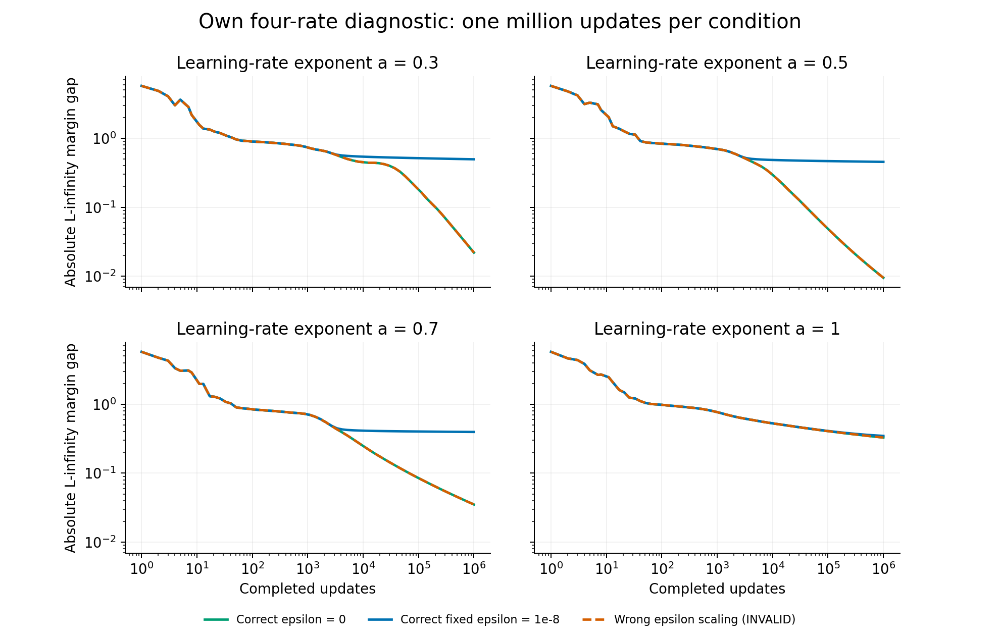

# Four-rate follow-up — 2026-11-12

**Status: partial qualitative reproduction; the fixed-positive-epsilon overlap remains unresolved.** We completed 12 additional million-update conditions on the frozen seed-2 dataset: four learning-rate exponents crossed with three recurrences. Three a=.5 conditions deliberately repeat the preceding audit and match its final weights exactly. These are AI-assisted independent experiments, not recovered author data or author code. The matrix was fixed before this round of production, informed by earlier diagnostics; it was not externally preregistered.

## Result and scope

Full-batch mean logistic loss; n=d=50; original PCG64 seed-2 data and independent initialization seed10002; beta1=.9, beta2=.99; no bias correction, intercept or weight decay; epsilon outside the square root; float64; eta_t=(t+1)^(-a), with t starting at zero. All conditions share data and initialization. The original run.py, protocol.json, conventions.py and prior evidence are unchanged.

Let z_i=y_i x_i and

\[
\gamma_\infty=\max_{\|u\|_\infty\le1}\min_i z_i^\top u,
\qquad q_\infty(w)=\frac{\min_i z_i^\top w}{\|w\|_\infty}.
\]

The table reports 100(γ∞−q∞(w))/γ∞, a relative **training margin gap**, not classification error or test accuracy. The reference optimum is computed on our own frozen dataset. It is not the paper's numerical reference.

| Learning-rate exponent a | Correct ε=0 | Correct fixed ε=10⁻⁸ | Wrong scaling: INVALID_RECURRENCE |
|---|---:|---:|---:|
| 0.3 | 1.523402% | 34.336483% | 1.523506% |
| 0.5 | 0.657242% | 31.511943% | 0.657301% |
| 0.7 | 2.434551% | 27.429596% | 2.434679% |
| 1.0 | 22.737828% | 24.072277% | 22.738188% |

The wrong-scaling control is numerically close to zero epsilon for all four rates, but that is not a valid repair. Correct positive epsilon has a much larger gap for a=.3/.5/.7. At a=1, even zero epsilon remains far from the optimum after one million updates, so close curves alone do not establish successful max-margin convergence. Rate ordering is data-dependent; our a=.5 result does not contradict the paper's discussion of a=.3 on its own data. No conditions were dropped.



This figure uses the **absolute** margin gap, as in the paper's Figure 2 quantity. The [single-rate figure](results/2026-11-12-multirate/figures/slide_epsilon_comparison.png) instead uses relative gap percent and focuses on a=.5. Neither is a copied author figure or a pointwise reconstruction of one.

## Why a tiny epsilon can change the update

For common moment scaling M=e^b m and V=e^(2b) v, the correct update is

\[
\frac{m}{\sqrt v+\epsilon}=\frac{M}{\sqrt V+e^b\epsilon}.
\]

Leaving epsilon untransformed gives M/(√V+ε), equivalent to an effective original-scale ε_eff=εe^(−b), not constant epsilon. The orange control explicitly implements this error to test a mechanism. Its similarity to the target behavior is evidence that such a mistake **can** matter, not evidence that the authors made it.

At the same stored moments, define a coordinatewise retained update factor

\[
A_j=\frac{\sqrt{v_j}}{\sqrt{v_j}+\epsilon}
=\frac{r_j}{1+r_j},\qquad r_j=\frac{\sqrt{v_j}}{\epsilon}.
\]

Where the zero-epsilon update is nonzero, A_j is the fixed-epsilon update magnitude divided by the zero-epsilon magnitude. It is not the fractional reduction, which is 1−A_j. The initial zero-moment 0/0 comparison is reported as undefined. No hidden denominator floor is inserted.

| a, correct fixed ε trajectory | First update with ε>√v in all coordinates | Maximum A_j at update 10⁶ | Cosine(update, −m) at update 10⁶ |
|---|---:|---:|---:|
| .3 | 3,036 | 0.00004718 | 0.99999999994 |
| .5 | 3,075 | 0.00055362 | 0.99999999159 |
| .7 | 3,964 | 0.00619533 | 0.99999892347 |
| 1 | Not reached by 10⁶ | 0.84005330 | 0.90611740776 |

Thus a=.3/.5/.7 end in a state where the denominator is dominated by epsilon and the update is nearly parallel to negative momentum. Momentum is also nearly parallel to the gradient re-evaluated at the stored weights. This is evidence of local momentum/gradient-like update geometry, not a proof of the eventual L2 max-margin limit. For a=1, only 70% of coordinates have √v≤ε at the endpoint; full epsilon dominance is not established.

The geometry comparison changes epsilon **at the same stored moments**, without retraining or replacing trajectory history. On zero-epsilon and INVALID trajectories, the fixed 10⁻⁸ probe is hypothetical. Stored weights are post-update; the moments came from the preceding gradient evaluation, and the reported current gradient is freshly evaluated at those stored weights. These quantities must not be described as gradients from the identical pre-update instant.

Exact epsilon-crossing update numbers were recorded during execution. All-checkpoint geometry is independently recomputed from saved states; unsaved updates and crossing times are not independently replayed.

## Low training loss is not a margin certificate

For the correct fixed-epsilon runs, the **first retained checkpoint** with mean logistic loss below 10⁻⁸ is:

| a | Saved update | Relative L∞ margin gap |
|---|---:|---:|
| .3 | 3,340 | 40.028899% |
| .5 | 4,159 | 34.817521% |
| .7 | 8,030 | 28.795727% |
| 1 | No retained checkpoint below threshold | — |

These are sparse recorded observations, not exact first crossings and not reruns with early stopping. They directly show why a small loss alone cannot certify that the normalized direction has reached a max-margin solution. For logistic loss R, ||∇R||∞≤B R with B=max_i ||x_i||∞, but v also depends on past gradients; loss alone does not determine √v/ε. The derivation and literature distinctions are in [FOLLOWUP_SOURCES.md](FOLLOWUP_SOURCES.md).

## Interpretation of the paper

The target paper's zero-epsilon theorem and its finite-positive-epsilon numerical observation are different claims. Our discrepancy concerns the latter on our declared data and implementation. The earlier audit already ruled out the tested common conventions, seeds and numerical representations as sufficient explanations in that matrix; it did not rule out every possible author setting.

An independent later paper, [Fan, Schmidt and Thrampoulidis, Appendix G, arXiv:2502.04664v4](https://arxiv.org/html/2502.04664v4), also reports an epsilon-dependent transition in a different multiclass setting. This supports investigating the mechanism, but is not a direct reproduction or evidence of an author bug. [Wang et al., §6.1, arXiv:2110.03891v2](https://arxiv.org/html/2110.03891v2) studies a different Adam convention and assumptions; its theorem is not silently transferred to our exact recurrence. See the source audit for these distinctions.

The target paper's Section 3 prose compares v with epsilon, whereas its denominator requires comparing √v with epsilon (equivalently v with epsilon²). This is a precision issue in interpreting the prose, not proof of erroneous code. We have not located verified public author code or the original random arrays. A third-party mirror of review discussions remains unauthenticated and is excluded from established claims. No author contact was made.

## Evidence and verification

The [snapshot](results/2026-11-12-multirate/README.md) retains every planned condition, inputs, reference, config, source hashes and 61 states per condition (732 total), including weights, both scaled moments and the log scale. The new runner reuses the frozen numerical kernels and provides a log-domain fallback when forming e^b epsilon would overflow.

Checks performed in this round:

- Six runner regression tests, including 300-step agreement with independently implemented raw Adam for all four rates and both valid epsilon conditions, log-scale stress cases, rejection of nonfinite states, event units, exclusive output creation and input identity/hash guards.
- Six transition-geometry invariants, plus exclusive-create/read-only CLI checks.
- Recomputed all 732 saved-state margins, losses and epsilon diagnostics, with maximum recorded metric difference zero; checked state shapes, finite values and endpoint consistency.
- All three a=.5 endpoint weight vectors match the previous convention audit exactly, maximum coordinate difference zero.
- Recomputed the full transition geometry and visually inspected both generated PNG figures.

The saved-state verifier does not independently reconstruct first moments through a full replay. The earlier 80/120-digit checks covered selected next updates, not full high-precision training. These are numerical checks, not formal proofs or a re-execution of every historical test.

From the repository root, using the locked paper50 dependencies:

```sh
export OPENBLAS_NUM_THREADS=1 OMP_NUM_THREADS=1 MKL_NUM_THREADS=1
python3 experiments/paper50/verify_multirate.py
python3 experiments/paper50/multirate_audit.py verify --output experiments/paper50/results/2026-11-12-multirate
python3 experiments/paper50/transition_geometry.py self-test
python3 experiments/paper50/transition_geometry.py verify --input-dir experiments/paper50/results/2026-11-12-multirate
```

For a full rerun and new plots, use new output directories:

```sh
python3 experiments/paper50/multirate_audit.py run --output artifacts/paper50-multirate-new --jobs 3
python3 experiments/paper50/transition_geometry.py analyze --input-dir artifacts/paper50-multirate-new
python3 experiments/paper50/plot_multirate.py --evidence artifacts/paper50-multirate-new --output artifacts/paper50-multirate-new-figures
```

See the [summary and Q&A](reproduction_update.md) for a short interpretation. The appropriate project label remains **partial reproduction with controlled discrepancy analysis**.
