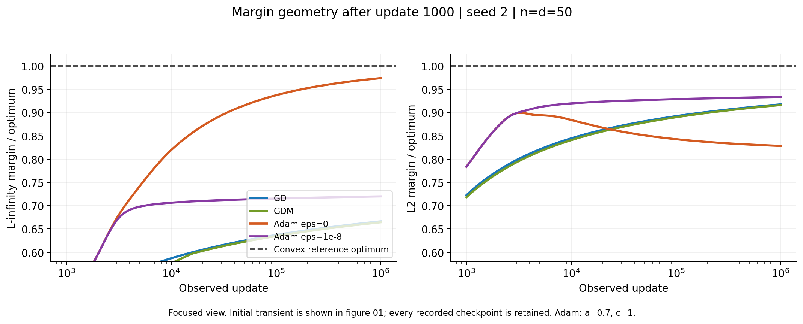

# Measured result snapshot — 2026-11-05

**Partial qualitative replication; exact author curves and epsilon similarity
were not reproduced.** All ten primary candidates and all formal outcomes are
reported. The implementation is independent and AI-assisted; see the
[source audit](../../SOURCES.md) and [rerun instructions](../../README.md).

## Scope and primary endpoints

The experiment used n=d=50, Gaussian features and independently sampled ±1
labels. Geometry-based selection chose seed 2; every method shared its
standard-normal initial vector (seed 10002). Primary Adam uses eta=(t+2)^(-.7),
c=1; GD/GDM use eta=.5/L=.5523791918775429 on this selected data set.

References: gamma-infinity=1.443493400289441 and gamma-2=.3300710995148639.

| Method, 1,000,000 updates | L-infinity margin | Relative gap | L2 margin | Relative L2 gap |
|---|---:|---:|---:|---:|
| GD | .96202957 | 33.354% | .30288040 | 8.238% |
| GDM | .95911162 | 33.556% | .30239310 | 8.385% |
| Adam epsilon=0 | 1.40580953 | 2.611% | .27344500 | 17.156% |
| Adam epsilon=1e-8 | 1.03946225 | 27.990% | .30813610 | 6.646% |

The preplanned a=.5, epsilon=0 sweep has L-infinity margin 1.4323878087048705,
relative gap .7693552033%, meeting the internal 1% finite criterion. None of the
40 primary endpoints meets its corresponding 1% target. This is a finite
descriptive result, not a proof of asymptotic convergence or a universal ranking.

| Across ten primary seeds | Relevant relative gap min / median / max | Within 1% |
|---|---:|---:|
| GD, L2 | 8.08% / 8.68% / 9.85% | 0/10 |
| GDM, L2 | 8.10% / 8.78% / 9.91% | 0/10 |
| Adam epsilon=0, L-infinity | 1.36% / 1.78% / 2.61% | 0/10 |
| Adam epsilon=1e-8, L-infinity | 22.76% / 30.23% / 40.96% | 0/10 |

See [all 50 formal endpoints](endpoints.json) for full-precision values.

## Difference from the paper

The no-epsilon condition approaches the L-infinity optimum, while GD/GDM's L2
margins increase. The paper's observation of similar epsilon=0/1e-8 curves was
not recovered with our declared c=1 schedules. At seed 2, epsilon=1e-8 dominates
at least one denominator coordinate by recorded checkpoint 2791 and all 50 by
checkpoint 4000. These are checkpoint bounds, not exact crossing times.

Author seeds, exact samples, selection metric, figure-1 learning rates and code
were not available in the inspected primary sources. Our substitutions are
declared choices. The sweep ranks a=.5 ahead of a=.3 at its final checkpoint,
unlike the ordering illustrated in the paper's figure. Finite log-log curves
neither prove a convergence rate nor refute the paper's asymptotic theorem.

## What is retained

- [Snapshot manifest and file hashes](snapshot.json): explicit retention scope,
  frozen code/protocol hashes, and per-file provenance.
- Ten generated input archives and convex-reference certificates in [datasets](datasets).
- All 50 formal configurations, original summaries and derived last saved
  states in [primary](primary), [rates](rates) and [epsilon](epsilon).
- Original checkpoint CSVs for all 14 selected-seed runs, including the two
  independently scheduled repetitions of a=.7.
- Five original complete checkpoint-state archives: four selected primary runs
  plus the prespecified a=.5, epsilon=0 rate run. Other full moment histories
  remain outside this compact Git snapshot; their original hashes are recorded
  in each summary. No omitted history is presented as retained.
- [Earlier full validation record](original-full-validation.json), covering 90
  runs and 68,440 checkpoints in the full experiment archive. That audit is
  distinct from the current compact-snapshot checker.

The complete study has 40 primary, 8 rate and 2 epsilon-control million-step
runs, plus 40 ten-thousand-step pilots: 50,400,000 updates. No numerical or
budget stop occurred. Primary wall time was 380.083960259 s and summed worker
CPU time 1093.52151507 s; overlapping suite wall times must not be added and
reported as a single elapsed duration.

## Verification and figures

Run `python3 experiments/paper50/verify.py` and
`python3 experiments/paper50/verify_snapshot.py` from the repository root.
The latter verifies retained bytes, exactly regenerates ten inputs, checks
primal/dual certificates, recomputes all formal endpoints and the retained full
checkpoint metrics. The original full audit's largest metric difference was
5.91e-12 and maximum independently recomputed reference residual was 1.68e-12.
Reference rejection tolerance was 1e-7. Full input states, formulas and residual
types are documented in the source audit.

Six new numerical checks, 19 existing workflow tests, nine exact-geometry
checks and six existing 2D checks passed. Process tests are not paper replication
evidence. Reproducible geometry and actual observed margins are the evidence here.

| Figure | PNG | SVG |
|---|---|---|
| Full selected margin trajectories | [view](figures/01_selected_margins.png) | [vector](figures/01_selected_margins.svg) |
| Step-schedule sensitivity | [view](figures/02_rate_sensitivity.png) | [vector](figures/02_rate_sensitivity.svg) |
| Loss and epsilon scale | [view](figures/03_loss_and_epsilon_scale.png) | [vector](figures/03_loss_and_epsilon_scale.svg) |
| All ten candidates | [view](figures/04_all_seeds.png) | [vector](figures/04_all_seeds.svg) |
| Additional epsilon controls | [view](figures/05_epsilon_controls.png) | [vector](figures/05_epsilon_controls.svg) |
| Focused margin geometry after update 1000 | [view](figures/06_selected_margins_detail.png) | [vector](figures/06_selected_margins_detail.svg) |

All figures show measured checkpoints. No paper image or theoretical curve is
substituted for an observation. The focused view omits the initial transient
explicitly; figure 01 and retained CSVs include it. Logged loss remains usable
when raw float64 loss underflows. No generalization or accuracy claim is made.
