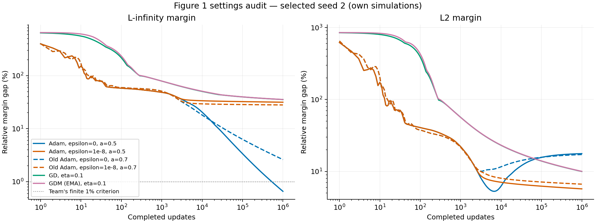
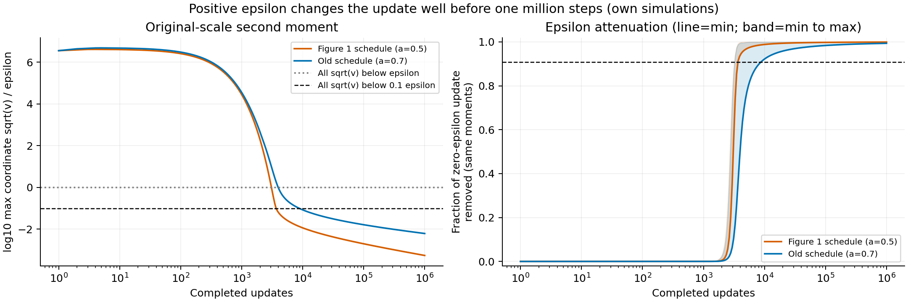

# Figure 1 alignment results — 2026-11-12

**Outcome: the missing Figure 1 settings are corrected; positive-epsilon
similarity remains unreproduced.** Nine independent runs of 1,000,000 updates
completed, with no budget or numerical failures (9 million updates total).
These are our AI-assisted simulations, not the authors' original results.

The old audit incorrectly said Figure 1 did not specify learning rates. The
rendered legends on page 7 of the [final conference PDF](https://proceedings.neurips.cc/paper_files/paper/2024/file/2ac79356a03fe5e9250e5e77ebc76e6e-Paper-Conference.pdf)
show Adam eta_t=t^(-.5), and GD/GDM eta_t=.1. See the corrected
[setting audit and commands](../../ALIGNMENT.md). Original measurements and the
frozen implementation/protocol are preserved in the 2026-11-05 snapshot.

## Measured results

The same geometry-selected seed 2 and standard-normal initialization are used
throughout. gamma_infinity=1.443493400289441; gamma_2=0.3300710995148639.
Relative gap means (gamma_p - min_i y_i x_i^T w / ||w||_p)/gamma_p.
This is a training-margin metric, not classification error or test accuracy.

| Condition | L-infinity gap | L2 gap |
|---|---:|---:|
| Old Adam, a=.7, epsilon=0 | 2.610602% | 17.155728% |
| Old Adam, a=.7, epsilon=1e-8 | 27.989816% | 6.645537% |
| Figure 1 Adam, a=.5, epsilon=0 | **0.657242%** | 17.668983% |
| Figure 1 Adam, a=.5, epsilon=1e-8 | **31.511943%** | 5.716445% |
| Index control Adam, a=.5, epsilon=0 | 0.769355% | 17.642225% |
| Index control Adam, a=.5, epsilon=1e-8 | 33.155508% | 5.685499% |
| Figure 1 GD, eta=.1 | 35.368657% | 9.977666% |
| Figure 1 GDM, eta=.1, normalized EMA | 35.459008% | 10.010723% |
| Literal Figure 1 Adam, epsilon=1e-8 | 31.511943% | 5.716445% |

Figure 1 uses code index t+1 (first learning rate 1); the old and index-control
runs use t+2. The authors' precise first-iteration indexing is unspecified.
The zero-epsilon gap falls by about 75% relative to the old primary condition;
it satisfies the team's descriptive 1% criterion. The old a=.5 rate sweep
already met that criterion. This audit aligns the main comparison and does not
present this rate choice as a newly discovered optimal hyperparameter.



## Why the positive-epsilon curves separate in our runs

For the Figure 1 positive-epsilon run, the first saved checkpoint with all
sqrt(v_j)<epsilon is update 3118. At checkpoint 3683, all coordinates satisfy
sqrt(v_j)<=0.1*epsilon. These are first *recorded* crossings; checkpoint spacing
does not establish the exact first crossing.

At that stronger threshold, epsilon removes at least 10/11 of each coordinate's
zero-epsilon update magnitude **for the same moment state**. At the millionth
step the removed fractions range from 99.944638% to 99.999492%. Thus epsilon
is no longer negligible in this data/initialization regime. The remaining
coordinate multipliers sqrt(v)/(sqrt(v)+epsilon) are not equal, so adding
epsilon changes both update magnitudes and their relative weighting.

This explains an observed mechanism in our runs. It does not identify how the
authors produced their curves, prove that their implementation is wrong, or
establish an asymptotic L2 limit from finite measurements. The epsilon=0 theorem
and the positive-epsilon empirical observation must be discussed separately.



## Validation and retained evidence

- All 9 conditions completed exactly 1,000,000 updates. Worker CPU total was
  about 164 seconds in this environment; this is not a paper resource claim.
- Recomputed all **2,376 saved checkpoints** from weights/moments. Maximum
  margin recomputation discrepancy: 0 at the recorded float64 precision.
- Compared scaled and independent literal positive-epsilon Adam across the
  full million-step run's saved checkpoints. Maximum absolute weight difference:
  **1.7763568394002505e-14**. This check covers the epsilon-dominated regime;
  the original 2,000-step test alone did not establish that.
- The four old-setting/index-control endpoints agree exactly, at stored
  float64 precision, with the corresponding old `endpoints.json` margin and
  relative-gap values. The new driver therefore preserves those baselines.
- Existing checks passed: 19 baseline workflow tests, 6 2D checks, 6 paper-scale
  numerical checks and 9 analytic geometry assertions. Three new regression
  checks cover learning-rate/index conventions, scale-invariant epsilon
  diagnostics, exclusive outputs and corrupted-evidence rejection.
- The old full snapshot was not redownloaded or rerun; its source, protocol and
  tracked result files are unchanged by this audit. The new saved evidence was
  verified in full within the checkpoint scope above.

`manifest.json` records the nine fixed configurations, source/environment hashes,
completed results and hashes of the raw evidence files. Each run directory retains
`config.json`, `trajectory.csv`, `states.npz` and `summary.json`; the common data,
reference certificates and protocol are stored alongside them. The manifest
hash list covers raw evidence, not this human-written interpretation or plots.
`verification.json` records the completed checkpoint and literal comparison.

Recheck this snapshot from the repository root:

```sh
export OPENBLAS_NUM_THREADS=1 OMP_NUM_THREADS=1 MKL_NUM_THREADS=1
python3 experiments/paper50/alignment.py verify --output experiments/paper50/results/2026-11-12-alignment
python3 experiments/paper50/plot_alignment.py --evidence experiments/paper50/results/2026-11-12-alignment --output artifacts/figure1-review/figures
```

Every plotted point is a measured checkpoint; connecting lines are visual guides,
not extra observations. The original authors' samples, first-step conventions
and exact GDM recurrence remain unknown. An exact-curve reproduction and an
explanation of the authors' epsilon-insensitivity remain open.
