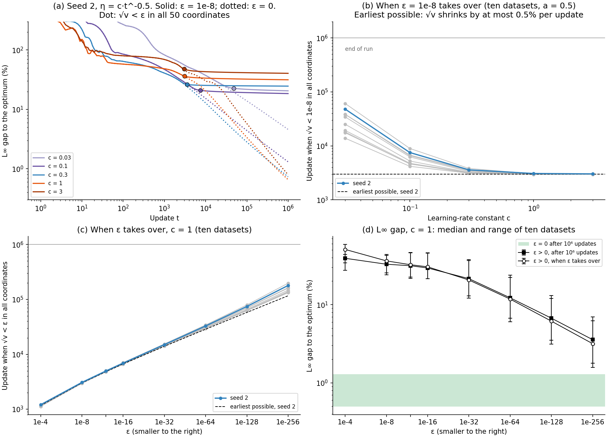

# When ε takes over — 2026-11-13

**Follow-up study, designed after all earlier results were known.** It is
material for the written report and is not shown on the slides. It uses the
figure-legend settings of [2026-11-13-legend](../2026-11-13-legend/README.md)
and changes only the values listed below. Settings:
[protocol_eps_timing.json](../../protocol_eps_timing.json); runs:
[eps_timing.py](../../eps_timing.py); tables and figure:
[plot_eps_timing.py](../../plot_eps_timing.py). Code and analysis were prepared
with AI assistance.

## Question

With ε = 1e-8, Adam ends 31.5% short of the L∞ optimum on seed 2, while
Adam without ε ends 0.66% short. When does ε start to matter, and does a
different learning rate change this?

We say that **ε takes over** at update t when, after that update, √v_j < ε in
all 50 coordinates. From then on ε is the larger part of the denominator
√v + ε, and the update becomes more and more like GD with momentum. The script checks this after every update,
with √v at its real size.

## What was run

200 runs of 10⁶ updates each, on the same ten datasets and initial vectors as
the legend run (averaged loss, β1 = 0.9, β2 = 0.99, no bias correction,
η_t = c·t^-a with t = 1, 2, …):

| Suite | Settings | Runs |
|---|---|---:|
| `c` | a = 0.5; c ∈ {0.03, 0.1, 0.3, 1, 3}; ε ∈ {0, 1e-8}; ten datasets | 100 |
| `a` | seed 2; a ∈ {0.3, 0.7, 1}; the same five c; ε ∈ {0, 1e-8} | 30 |
| `epsilon` | a = 0.5, c = 1; ε ∈ {1e-4, 1e-12, 1e-16, 1e-32, 1e-64, 1e-128, 1e-256}; ten datasets | 70 |

Runs with ε = 0 also record when √v falls below each of these ε values. In
these runs ε does not change the path, so they show where on Adam's own path
each ε would start to matter. The c = 1, a = 0.5 runs repeat the legend run and
give the same numbers (seed 2: 0.657% without ε, 31.512% with ε = 1e-8). All
200 runs finished without numerical errors.



## Results

### 1. ε cannot take over before about 3,000 updates, whatever the learning rate

Without bias correction, v_t = β2·v_(t−1) + (1 − β2)·g_t² ≥ β2·v_(t−1). So √v
can shrink by at most a factor √0.99 per update, which is about 0.5%. After the
first update √v_j = 0.1·|g_1,j|, and its largest coordinate is 0.021–0.035 on
the ten datasets. To fall below ε in every coordinate, √v therefore needs at
least

t ≥ 1 + 2·ln(max_j √v_1,j / ε) / ln(1/β2)

updates. For ε = 1e-8 this is 2,900–3,002 updates (3,001 on seed 2). The bound
uses only β2, ε and the first gradient, not the learning rate. Each factor of
10 in ε adds 458 updates.

### 2. With the legends' c = 1, ε takes over at this earliest time

Ten datasets, a = 0.5, ε = 1e-8:

| c | ε takes over (update) | × earliest possible | L∞ gap then | L∞ gap after 10⁶, ε = 1e-8 | L∞ gap after 10⁶, ε = 0 |
|---:|---|---|---|---|---|
| 3 | 2,965–3,048 | 1.00–1.05 | 33.7–72.3% | 27.4–64.4% | 0.66–2.06% |
| **1** | **2,963–3,075** | **1.00–1.04** | **25.4–44.0%** | **24.2–42.9%** | **0.50–1.29%** |
| 0.3 | 3,113–3,816 | 1.05–1.31 | 21.3–42.6% | 22.6–42.6% | 0.46–0.95% |
| 0.1 | 4,179–8,951 | 1.41–3.07 | 13.6–28.2% | 18.5–33.3% | 0.82–1.31% |
| 0.03 | 13,856–60,906 | 4.68–20.91 | 12.7–26.0% | 15.4–27.0% | 2.08–4.60% |

Seed 2 takes over at updates 3,026 / 3,075 / 3,593 / 7,523 / 47,969 for
c = 3 / 1 / 0.3 / 0.1 / 0.03, and ends 40.5 / 31.5 / 24.6 / 18.5 / 20.5% short.

- With c = 1 or 3 the loss falls so fast that √v shrinks at the largest
  possible rate. ε takes over at 1.00–1.05 times the earliest possible update.
- A smaller c delays the takeover, up to about 61,000 updates at c = 0.03.
  But Adam then also moves more slowly. When ε takes over, the gap is still
  12.7–28.2% for c ≤ 0.1.
- The other exponents on seed 2 give the same picture. With a = 0.3, ε takes
  over at updates 3,025–5,707 and the runs end 17.5–42.5% short. With a = 0.7
  and c ≥ 0.1, ε takes over at updates 3,089–211,545 and the runs end
  20.2–39.0% short. With a = 1, ε takes over only at c = 3 (update 10,660); for
  c ≤ 1, Adam without ε is itself still 22.7–396% short after 10⁶ updates. With
  a = 0.7 and c = 0.03, both runs end 37% short.

### 3. After ε takes over, the gap improves little

In the 60 runs where ε = 1e-8 took over, the gap fell by at most 13.3
percentage points between the takeover and update 10⁶. In some runs it rose
again, by up to 6.2 points. Over all 65 runs with ε = 1e-8, the smallest gap
at any recorded update was 12.3% (seed 1, c = 0.03). In the 57 pairs where Adam
without ε ended within 5% of the optimum, the matching run with ε = 1e-8 ended
15.4% short or more.

### 4. Only a much smaller ε gets close

c = 1, a = 0.5, ten datasets:

| ε | ε takes over (update) | earliest possible | L∞ gap after 10⁶ | seed 2 |
|---:|---|---|---|---:|
| 1e-4 | 1,119–1,206 | 1,067–1,169 | 27.4–43.8% | 39.88% |
| 1e-8 | 2,963–3,075 | 2,900–3,002 | 24.2–42.9% | 31.51% |
| 1e-12 | 4,803–5,012 | 4,733–4,834 | 22.6–45.9% | 28.02% |
| 1e-16 | 6,640–7,046 | 6,566–6,667 | 21.5–45.6% | 25.33% |
| 1e-32 | 14,219–15,445 | 13,897–13,999 | 13.0–37.6% | 16.20% |
| 1e-64 | 29,645–34,233 | 28,560–28,661 | 6.7–23.8% | 8.72% |
| 1e-128 | 61,987–79,408 | 57,885–57,987 | 3.5–13.1% | 4.61% |
| 1e-256 | 132,394–197,428 | 116,536–116,638 | 1.8–7.0% | 2.37% |
| 0 | never | — | 0.50–1.29% | 0.66% |

For ε from 1e-4 to 1e-16 the takeover comes at 1.00–1.07 times the earliest
possible update. For smaller ε it comes later (1.14–1.69 times at 1e-256; seed
2: 179,543 against 116,637), because by then the loss falls more slowly than
the bound allows.
Even ε = 1e-256, far below any value used in practice, leaves a gap of 1.8–7.0%.

## What this means

- When ε starts to matter is set mainly by β2 = 0.99 and the size of ε, not by
  the learning rate. With the legends' c = 1, ε = 1e-8 takes over after about
  3,000 updates on every dataset.
- For every learning-rate constant from 0.03 to 3 and every exponent from 0.3
  to 1, the runs with ε = 1e-8 ended at least 15% short and never came within
  12% of the optimum. A different learning rate therefore does not explain why
  the paper's ε = 1e-8 curves look like its ε = 0 curves.
- A larger β2 moves the earliest takeover later: with β2 = 0.999 it is 27,836
  updates on seed 2. That setting still ended 42.4% short in the 56-setting
  check ([DIAGNOSIS.md](../../DIAGNOSIS.md)), so a later takeover alone does
  not help.
- The remaining explanations are those in
  [2026-11-12-posthoc](../2026-11-12-posthoc/README.md): an implementation in
  which ε does not act at its real size (for example, ε added after a rescaling
  of the gradient), or a setting the paper does not state. Without the
  authors' code we cannot check this.

## Limits

- Post-hoc and exploratory: the design was chosen after the earlier results
  were known.
- Our datasets differ from the paper's (seed 2: γ∞ = 1.443 and γ2 = 0.330; the
  paper's figure 1 shows about 1.68 and 0.475), and the runs stop at 10⁶ updates.
- The takeover uses all 50 coordinates. The first coordinate falls below ε
  earlier (seed 2, c = 1: update 2,705).
- The bound assumes no bias correction, as in §5. With bias correction the
  factor 1/(1 − β2^t) is within 1e-13 of 1 by update 3,000, so the bound does
  not change.

## Files and rerun

`endpoints.json` lists every run, with the update, gap, norm and loss at each
threshold crossing; `summary.json` holds the tables above; `manifest.json`
records the runner, protocol and dataset hashes and the software versions. Each
run folder has `config.json` and `summary.json`; the seed-2 runs of suite `c`
also keep `trajectory.csv.gz` (all recorded checkpoints), which panel (a)
reads. From the repository root:

```sh
export OPENBLAS_NUM_THREADS=1 OMP_NUM_THREADS=1 MKL_NUM_THREADS=1
python3 experiments/paper50/eps_timing.py --output artifacts/eps-timing-new --jobs 10
python3 experiments/paper50/plot_eps_timing.py artifacts/eps-timing-new
```

The 200 runs took 11 minutes on 10 workers (numpy 2.3.5, SciPy 1.17.0).
